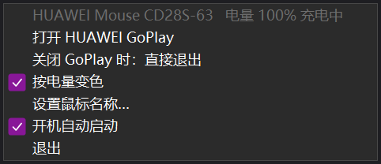

# HUAWEI 星闪鼠标 · 任务栏电量托盘

[](LICENSE)


把 HUAWEI 星闪鼠标（`CD28S-63`）的电量常驻在任务栏通知区：**悬停看电量与充电状态，左键拉起
HUAWEI GoPlay，右键管图标样式、GoPlay 关闭策略和开机自启。**

只用 Windows 自带的 PowerShell 5.1 实现：不需要 .NET SDK、不需要 Python、不需要装服务或驱动，
常驻资源就是一个 powershell 进程加一条 1 秒节拍。

> **非官方项目**，与华为技术有限公司无关，详见 [NOTICE](NOTICE)。



## 它解决什么问题

Windows 只在「设置 → 蓝牙和设备」里显示一次缓存电量，`HUAWEI GoPlay` 又必须点开才看得见数字。
这个托盘把两者缝在一起：鼠标状态一眼可见，GoPlay 点 X 之后不再偷偷留在后台。

- **电量 + 充电状态**：优先后台 GoPlay 的 USB 轮询日志，退回 Windows 缓存的 BLE 电池属性
- **图标三档变色**：≥60 绿 / 36–59 黄 / ≤35 红，也可切换为跟随系统深浅色
- **细 / 粗两套图标**，按 DPI 原生像素渲染，24px 下和系统托盘字形对齐
- **GoPlay 单实例 + 关闭即退**：点 X 直接结束进程，或按需最小化到托盘
- **开机自启**、自定义显示名、单实例互斥体（不会出现两个图标）

## 快速开始

1. 到 [Releases](../../releases) 下载最新 zip，解压到一个固定目录（**别放 `Program Files`**，
   它要在自己旁边写 `settings.json` 和日志）。
2. 双击 `HuaweiMouseTray.exe`；不想看到黑框就运行 `start-hidden.vbs`：

   ```powershell
   wscript.exe //nologo start-hidden.vbs
   ```

3. 右键托盘图标 → 勾上 **开机自动启动**。

想确认环境是否就绪，跑一次自检（只读状态、不建托盘）：

```powershell
powershell -NoProfile -STA -ExecutionPolicy Bypass -File .\HuaweiMouseTray.ps1 -Once
```

```json
{"Connected":true,"Name":"HUAWEI Mouse CD28S-63","Level":95,"Charging":true,"Full":false,
 "GoPlayRunning":false,"GoPlayVisible":false,"GoPlayCloseMode":"exit",
 "LevelColor":true,"ThinIcon":true,"Icon":"...\\icons\\thin\\tray.ico","IconExists":true,"Autostart":true}
```

## 运行环境

| 需要 | 说明 |
| --- | --- |
| Windows 11 | 依赖 `CfgMgr32` 的蓝牙电池属性与 DWM 深浅色设置 |
| Windows PowerShell 5.1 | 系统自带，无需安装 PowerShell 7 |
| HUAWEI GoPlay（可选） | 想在托盘里看到「充电中/已充满」，它得在后台跑着；彻底退出后只能看电量 |

## 电量是从哪来的

**首选：GoPlay 的 USB 日志** `%LOCALAPPDATA%\HUAWEI GoPlay\NeoUsb.log`，里面两种行：

```
PowerValue=100 and n_nIsPowering=1
get power value 100 power state 2
```

`power state` 0 = 电池供电、1 = 充电中、2 = 已充满。日志 24 小时没更新就视为失效。

**兜底：Windows 缓存的 BLE 电池属性**（`CM_Get_DevNode_PropertyW`，单次约 0.15 ms）。
这条路只有电量、没有充电状态，提示里会多一个「（缓存）」。

格式细节见 [说明书第 4 节](docs/manual.zh-CN.md)。

## 配置

改右键菜单即可，改动会写回 `settings.json`（仓库里提交的是 `settings.example.json`，
可以复制一份改成自己的）：

| 键 | 默认 | 说明 |
| --- | --- | --- |
| `goPlayClose` | `"exit"` | `exit` = 点 X 后结束 GoPlay；`minimize` = 留在后台 |
| `levelColor` | `true` | 按电量三档变色；关掉则跟随系统深浅色 |
| `thinIcon` | `true` | 细图标 / 粗图标 |
| `displayName` | `""` | 自定义名称，空则用设备名 |
| `goPlayPath` | `""` | GoPlay 的 exe 路径；留空则自动从注册表探测 |
| `goPlayCloseMinAlive` | `5.0` | 判定「用户关掉了」所需的进程存活秒数 |
| `goPlayCloseMinVisible` | `0.5` | 判定所需的窗口连续可见秒数 |
| `killGoPlayOnExit` | `false` | 退出托盘时是否把 GoPlay 一起结束 |

GoPlay 装在非默认位置、注册表也探测不到时，除了 `goPlayPath`，还可以设环境变量
`HUAWEIMOUSETRAY_GOPLAY`。

## 自定义图标 / 重新构建

```powershell
# 托盘图标 + 应用图标（需要 Python 3 + Pillow + numpy）
python tools\make_tray_icons_v3.py

# 重新编译 launcher（内嵌 icons\app.ico，目标 .NET Framework 自带编译器）
powershell -File tools\build_exe3.ps1
```

图标不是位图放大，而是从品牌规范的两个「D」矢量轮廓分别取出后按尺寸重画的：
`FILL`（占位）、`WEIGHT_THIN` / `WEIGHT_BOLD`（粗细）、`GAP`（两片之间的缝宽，0 = 相连）、
`COLORS` 都在脚本顶部。细节见 [说明书第 11 节](docs/manual.zh-CN.md)。

## 目录结构

```
HuaweiMouseTray.ps1     主程序：托盘、电量、单实例、GoPlay 策略、菜单
menu-theme.ps1          菜单深浅色/强调色、自绘勾选框
dpi-aware.ps1           声明进程 DPI 感知
start-hidden.vbs        静默启动器（不闪控制台）
settings.example.json   设置模板
icons/                  thin|bold 两套托盘图标 + app.ico
tools/                  图标生成、exe 编译、HID/GATT 协议探测脚本（legacy/ 为旧版）
docs/                   说明书与配图
```

## 排错

一切问题先开 trace：

```powershell
powershell -NoProfile -STA -ExecutionPolicy Bypass -File .\HuaweiMouseTray.ps1 -TraceFile .\trace.log
```

现象对照表、单实例规则、GoPlay 关闭判定的闸门逻辑，都在
[说明书 docs/manual.zh-CN.md](docs/manual.zh-CN.md) 里（含「已知限制」一节）。

## 贡献

欢迎 issue 和 PR，先看 [CONTRIBUTING.md](CONTRIBUTING.md)。报 bug 时附上 `trace.log` 和
`-Once` 的输出最省事。

## 许可证

源代码以 [MIT](LICENSE) 发布。`icons/` 下的品牌图标不属于 MIT 授权范围，
商标权归华为所有，再分发前请阅读 [NOTICE](NOTICE)。
